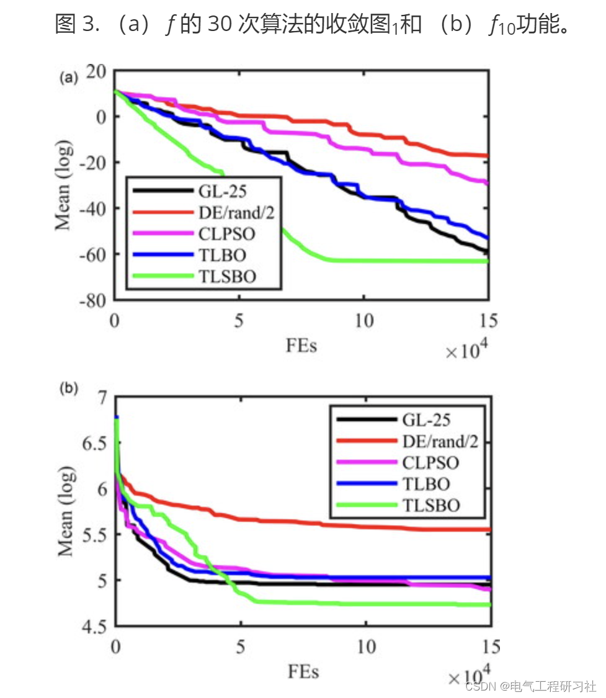
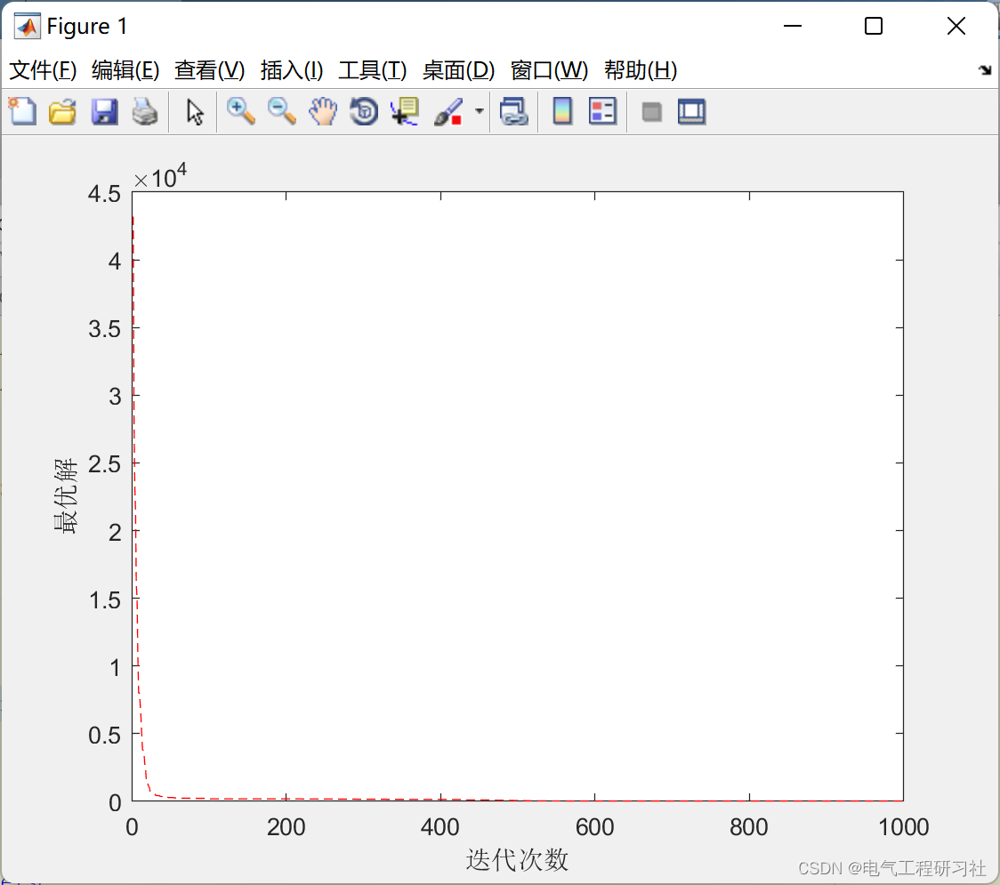

# MATLB|Optimization Algorithm for Improving Teaching (TLSBO)

​  
📋📋📋This article is organized as follows: ⛳️⛳️⛳️Table of Contents: 1. Overview 2. TLBO Algorithm 2.1 Teaching Phase 2.2 Learning Phase 2.3 Research Phase (Recommended Strategies) 2.4 Multi-objective TLSBO Strategy 3. Real-Parameter Problems with TLSBO Algorithm 4. Solving OPF Problems Using the TLSBO Algorithm 5. Conclusion 6. Final Thoughts
1. Overview In recent years, the population-based group intelligence based on various evolutionary algorithms (EA) has been a significant research interest among many researchers in various fields seeking optimal solutions to problems, such as optimal solutions to various types of engineering optimization problems in engineering systems.Therefore, various heuristic techniques and evolutionary algorithms are required to effectively and acceptably solve and find the optimal solutions for engineering optimization problems. General optimization methods such as Particle Swarm Optimization (PSO) algorithm [1], Turbulence-based Optimization [2], Differential Evolution (DE) algorithm [3], Artificial Bee Colony (ABC) [4], and Teaching-Learning Based Optimization (TLBO) [5] have been proposed in the literature. These papers can find effective and acceptable optimal or near-optimal solutions for many engineering and real-world optimization problems with many nonlinear characteristics within acceptable and fast simulation times.Furthermore, classical optimization methods are inefficient and unacceptable for solving most engineering and practical optimizations, as they only compute local optima [6].
TLBO is one of the most successful metaheuristic optimization algorithms, with numerous studies focusing on enhancing its performance through various strategies; some of these include Interactive Teaching Optimizer (ITLO), which is used for optimal adjustments in VSC-HVDC systems [18], TLBO algorithms with dynamic group strategies [19], adaptive inertia weights TLBO [20], improved TLBO for parameter extraction in photovoltaic models [21], hybrid TLBO and neural network algorithms [22], a chaotic TLBO [23], and dynamic anti-learning enhancement [24]. This paper proposes a new strategy to enhance the performance of TLBO and helps it converge to local optima.
OPF issues, as a major problem in power system operation, have been resolved using numerous classical optimization methods, such as Newton's method, quadratic programming, interior-point methods, linear programming, and nonlinear programming [7]. However, these methods encounter difficulties when dealing with non-convex and/or non-smooth problems. Moreover, they are slow in solving large-scale problems and may linger in local optima. Therefore, in recent years, natural-inspired metaheuristic optimization algorithms have been widely applied to solve OPF problems. This paper proposes and develops an efficient strategy for solving various types of nonlinear optimal power flow (OPF) problems in power systems within the original TLBO algorithm.It has good feasibility and performance in solving various engineering optimization problems, such as: distribution system state estimation [9], improved mutagenesis primer design [10], parameter optimization of selected casting processes [8], spatial truss design [11], dynamic economic emission dispatch (DEED) [12], minimization of energy loss [13], multi-level production optimization in the petrochemical industry [14], compensation for control hard drive video recorders [15], flexible job shop scheduling [16], parameter identification of PEM fuel cell and solar cell models [17] and so on.
This article is structured as follows: Section 2 presents the original TLBO and introduces the proposed strategies. Section 3 contains the Matlab simulation code, which compares the optimization results of standard real parameter test functions under different algorithms. Section 4 uses the TLBO algorithm to solve the optimal power flow (OPF) optimization problem for power systems. Finally, Section 5 provides some conclusions of this paper. The teaching-based optimization algorithm (TLBO) is a powerful and efficient optimization algorithm. However, it can easily fall into local optima. To enhance the global optimization performance of TLBO, an improved version of TLBO, called the Teaching-Learning Based Optimization Algorithm (TLSBO), is proposed in this paper.Enhanced functionality is based on the addition of a new strategy to TLBO, known as the research strategy, where each member improves its position using information from another randomly selected individual. Subsequently, TLBO is employed for solving various benchmark functions of standard real-parameterized problems and various types of nonlinear optimal power flow (OPF) problems. The results indicate that TLBO has faster convergence speed, higher quality of final optimal solutions, and escape capability from local optima compared to the original TLBO.2. TLBO algorithm - Teaching-Learning-Based Optimization (TLBO) is a teaching optimization algorithm designed by Rao and others to simulate the teacher-student learning process in classroom settings. It treats the entire population as a class, with the best individuals within the population acting as teachers, while the rest act as students. The algorithm consists of two phases: teaching and learning.
This implies that the class collectively learns from teachers; during this stage, students learn from each other. Through the synergistic evolution of these two phases, the overall level of the population is enhanced.
2.1 During the teaching phase, the individual with the best fitness value in each iteration will be selected as the teacher editor. The average score of the class is the editor, and teachers hope that students in the class can approach both themselves and the class average during the teaching process. Therefore, the position iteration formula is as follows: (1) represents:
Editor
Among them, "edit" is used as a teaching factor to reflect the degree of influence on the average score of the class, generally taking 1 or 2. "Edit" represents the new state after teaching phase learning; "Edit" is a random number in the range [0,1] before student learning.
2.2 After the class ends in the learning stage, This phase simulates the process of students learning from each other. Students in order to further improve their own learning level. Engage further with other individuals in the class. Students randomly select students. Compare the adaptability values of two students. Subtract the position of the excellent student from that of the inferior one. Taking the minimum value optimization problem as an example. Learn in the following manner (2):
Among them, the random numbers are [0,1]. Compare the results before and after updating, and keep the better solution.
All students (particles) are divided into two stages of training until the iteration count is reached.
2.3 Research phase (recommended strategy) 2.4 TLSBO's multi-objective strategy 3 The TLSBO algorithm for real parameter problems in the first part of the simulation study, to verify the performance of the TLSBO algorithm in real parameter optimization, various types of real parameter functions were selected [27] based on average (average of best results), best (best result from all runs), and Std (standard deviation of best results), which are summarized in the appendix.In this section, the features of GL-25 include general performance, robustness, and precision [28], German/Lanterna/2 [29], (F (proportion factor) = 0.45, CR (cross factor) = 0.7), CLPSO [30], comparing the original TLBO with the proposed TLsbo algorithm using 12 real parameter test functions summarized in [27]. The real parameter test functions are multimodal, non-separable, and scalable, having very long, narrow, and parabolic valleys from local minima to global minima, making them difficult to solve [27]. Each algorithm runs 30 times for each real parameter test function, results including mean, best, and standard values table 1. In these simulations,The overall size is considered as N = 30, the maximum value of function evaluation is FE = 150,000, and the dimension D = 30.In this table, the rank shows the order of average indices for each algorithm. Nb is the number of times the algorithm outperforms other algorithms, Nw is the number of times the algorithm performs worse than others, and Mr is the average rank of all functions. The results indicate that the proposed TLSBO algorithm surpasses the original TLB0 and other algorithms in terms of obtaining better final solutions and less convergence to local minima. The results also show that the TLSBO algorithm successfully addresses different real-parameter optimization problems. The mean values of the convergence graphs for 30 algorithm runs of f1 and f10 test functions are shown in Figure 3.
Editor
The iterative effect of this algorithm is still very good. For detailed explanations of the program and article, please refer to:
4. Solution of OPF Problems Based on TLSBO Algorithm
Generally, the objective of an OPF problem is to optimize one or more objective functions by optimally adjusting control parameters of a power system, subject to some equalities and inequalities [31,32]. In recent literature (since 2014), the summary of optimization algorithms used to solve different OPF problems are based on decomposition-based algorithms [33], Evolutionary Algorithms (EA) [34], Improved Multi-Objective ABC Algorithm [35], Multi-Bee Honey Bee Foraging Algorithm (MHBFA) [35], Modified TLBO [36], Improved Adaptive DE [37].Hybrid Fuzzy Particle Swarm Optimization and Nedler-Mead Algorithm (HFPSO-NM) [38], Learning DE-APSO-PS [39] a suitable GA with adjustable population size [40], PPO based on adaptive biogeography [41], Adaptive Clonal Selection Algorithm [42], PSO [43], PSO, EP, GA, GWO and DE [44,45] Backtracking Search Optimization Algorithm (BSOA) [46], Based on oppositional game theory GSA [47], A model based on semidefinite programming [48], Probabilistic Multi-objective Algorithm [49], Improved ABC (IABC) [50–53]Parallel NSGA-II [54];A new sinusoidal-cosine algorithm (SCA) [55], security gate point [56], an improved gravity search algorithm (EGSA) [57], enhanced group search optimization (IGSO) [58,59], chaotic invasion weed optimization (CIWO) algorithm [7], modified bacterial foraging algorithm (MBFA) [60], opportunity constrained framework [61], social spider optimization (SSO) algorithm [62], modified Jaya algorithm [63], an improved DE algorithm integrated with effective constraint handling techniques [64], biogeographic optimization (BBO) [65,66], an enhanced Pareto evolutionary method [67], bats [68].The Solution Method for Biphenyl [69,70], an Improved Multi-Objective Multi-Attribute Optimization (IMOMVO) Algorithm [71], Quadratic Optimization of Contrastive Search (QOCS) [72], Chaotic KHA [73], Non-Dominant Separation of Mixed CSA [74], Hybrid Algorithm of MSA and GSA [75], Internal Search Algorithm (ISA) [76], Forced Initialization DE [70], a Quadratic Improvement of Jaya Algorithm [77], Firefly Swarm Optimization (GSO) [78], Multi-Objective Ant Lion Algorithm (MALA) [79], Improved Collision Body Optimization (ICBO) [80], A Novel Mixed Integer Nonlinear Planning Model [81].Improved Firefly Algorithm [82], a new TLBOP using Lévy mutation strategy [83], hybrid PSO with MVO [84], improved Bat Algorithm [85], DSA [86], hybrid PSOGSA [87], screw KHA [88], fuzzy and harmony search (FHS) [89], adaptive FFA [90], modified MOEA/D [67,91], class electromagnetic algorithm (ELA) [92], enhanced adaptive DE [93] and moth swarm algorithm (MSA) [94].
5 Conclusions The TLSBO algorithm, a new version of the TLB0 algorithm based on a group-based unparameterized simple optimization algorithm, demonstrates better and more acceptable performance across various engineering optimization problems. In this study, by adding a novel strategy (the research strategy) to the original TLB0, we propose a new version of the TLB0 algorithm, TLSBO. The TLSBO algorithm was applied to optimize 12 benchmark real-parameter functions and various types of optimization problems, and its results were compared with those reported in previous literature. Simulation results show that the proposed TLSBO algorithm has good, efficient, and robust optimization performance compared to the original TLB0 algorithm and other previously proposed algorithms, exhibiting faster convergence when dealing with various types of optimization problems.
Improving TLSBO through the use of concepts such as chaos, Levy Flight, and multi-group, and blending the proposed algorithm with other successful metaheuristic methods may be future research topics.
6 End Notes Theoretical references are cited from online literature sources, and if any infringement is found, please contact the blogger for removal.

## Images

<!-- PAYMENT_BLOCK -->

## Get this dataset

- Payment link (Stripe): [Buy now](https://buy.stripe.com/3cs8yP7sY87d0vu9AB)
- Payment QR code: 

<!-- /PAYMENT_BLOCK -->
